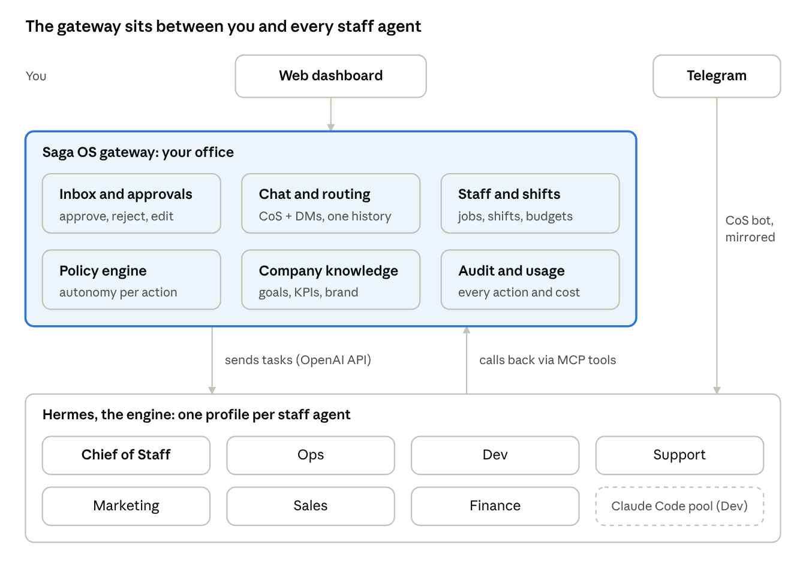
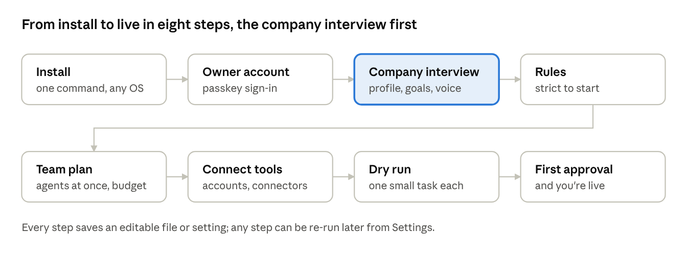
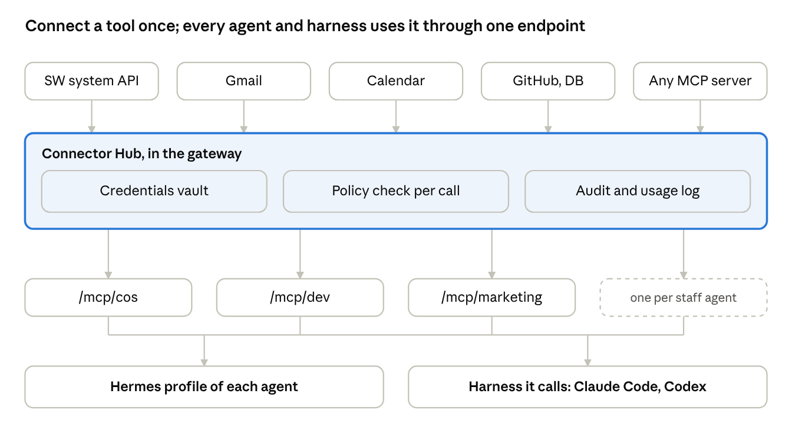
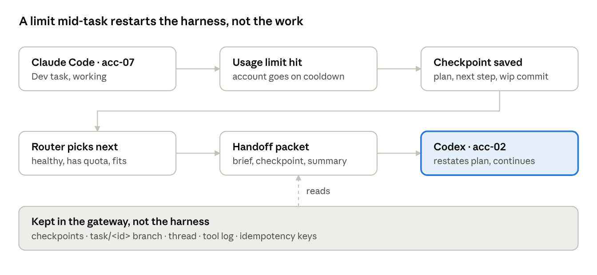
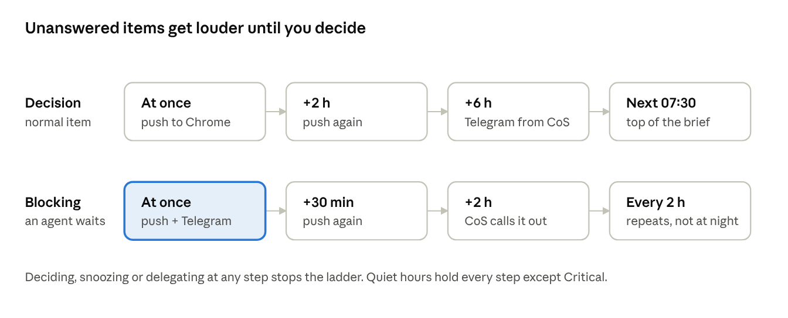
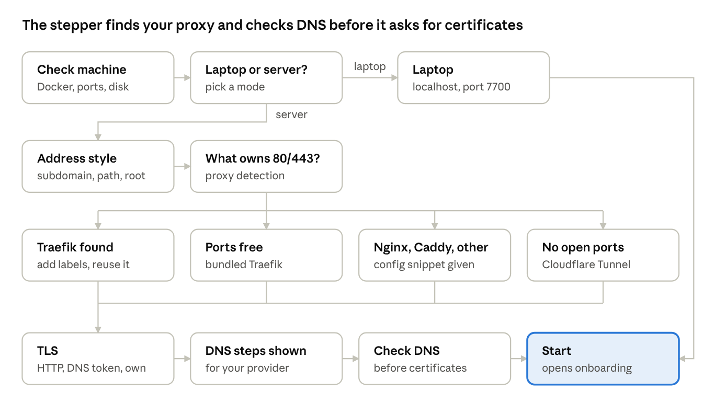
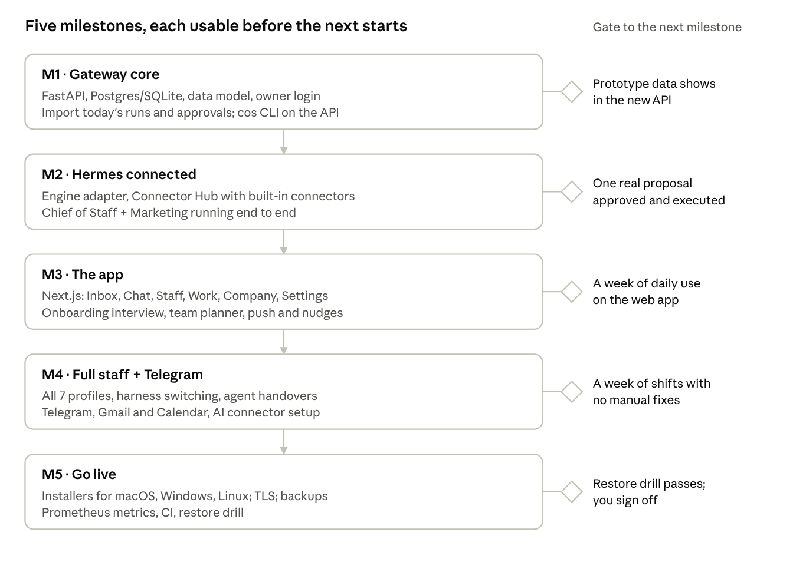

# Saga OS — Spec v1

Draft · 15 Oct 2026 · Dede Kurniawan

## Summary

Saga OS becomes the **gateway between the founder and his staff agents**: every message, task, approval and report passes through it, and Hermes does the thinking and the work behind it. The current build (loops, runner, dashboard, chat) is the prototype; v1 turns it into a product that installs in one command, explains itself, and is safe to leave running.

**It is a product, not a Sahabat Warga tool.** Saga OS is an open-source platform any owner can install for any company: nothing about Sahabat Warga is built in. A first-run onboarding learns the company (what it does, goals, rules, voice) and recommends a team of agents sized to how many the owner wants running at once. It installs and runs on macOS, Windows and Linux. Sahabat Warga is the first company to run on it, and the example used throughout this spec.

| Decision | Choice | Why |
| --- | --- | --- |
| Engine for staff agents | Hermes, one profile per staff agent | Memory, skills, cron, tools and Telegram already exist in Hermes; the gateway should not rebuild them |
| Coding work | Claude Code / Codex as tools Hermes calls | Keeps the 25-account pool useful for the heavy work |
| Gateway stack | FastAPI (Python) + Next.js, Postgres (SQLite for local) | Reuses today's Python logic; Next.js fits the Finity design system |
| Founder channels | Web dashboard + Telegram via Hermes | Desk work on web, quick decisions on the phone |
| Process | Spec first, then build milestone by milestone | This document is the spec |
| Distribution | Open source, company-agnostic; onboarding sets up each company | Any owner can run their own company on it; Sahabat Warga is the first |
| Where it runs | macOS, Windows, Linux; laptop or server | Owners start on their laptop and move to a server when it runs all day |

The one rule that does not change: **agents propose, the founder decides.** Anything that leaves the company, spends money or touches production needs the founder's OK, enforced by the gateway, not by prompts.

## Architecture

The gateway owns **who, what's allowed, and what happened**; Hermes owns **thinking and doing**. They talk in two directions: the gateway sends work to Hermes over its OpenAI-compatible API, and agents call back into the gateway through one MCP server.



Work goes down to Hermes as tasks; agents come back up only through MCP tools, where the policy engine decides what is allowed.

| Concern | Gateway (Saga OS) | Hermes |
| --- | --- | --- |
| Founder identity, login, sessions | owns | — |
| Routing a message to the right staff agent | owns (Chief of Staff by default) | — |
| Agent reasoning, tools, memory, skills | — | owns |
| Schedules (shifts) | owns the calendar, triggers the run | executes the run |
| Policy and approval gates | owns, enforced server-side | asks via `propose` / `ask_founder` |
| Company knowledge (goals, KPIs, brand, pricing) | owns, serves via `get_context` | reads it |
| Audit log, usage and budget | owns | reports usage per task |
| Telegram | mirrors threads and inbox items | runs the bot (Chief of Staff profile) |
| Outside tools (Gmail, Calendar, own systems) | owns credentials, grants and the MCP endpoints (Connector Hub) | uses them as MCP tools, never sees tokens |

**Three flows**

1. *Founder asks something.* Web or Telegram → gateway thread → Chief of Staff profile. CoS answers, or delegates to a staff agent as a task; the task gets its own thread, linked back.
2. *A shift runs.* Gateway scheduler → creates a task for the staff agent → Hermes profile works, calling `get_context` / `report` / `propose` → gateway stores the report and puts proposals in the Inbox.
3. *A proposal is decided.* Founder approves, rejects or edits in the Inbox (or tells CoS on Telegram) → gateway records the decision → sends an `execute` task to the same agent → the agent executes only the approved text and calls `report`.

## What the founder sees

Six words cover the whole product, and each maps to something a founder already understands about running a team. No "loops", "harness" or "runs" in the UI.

| Concept | What it is | Replaces in today's build |
| --- | --- | --- |
| **Inbox** | Everything that needs you: approvals, questions from staff, alerts, failed work. Each item: approve, reject, edit, or reply. Zero = nothing to do. | Approvals tab + "Needs attention" |
| **Chat** | Talk to the Chief of Staff (default) or DM any staff agent. Every task, report and inbox item has its own thread. Same threads on Telegram. | Chat tab + run/approval chats |
| **Staff** | One card per agent: role, job description, schedule, permissions, autonomy, budget, KPIs, last activity. Hire, pause, edit. | Loops (loop.json + prompt.md) |
| **Work** | Timeline of tasks: who did what, when, result, cost. Filter by agent or status. | Runs tab |
| **Company** | Goals, KPI scorecard, and the knowledge every agent reads (brand voice, pricing, systems, customers). Editable. | company/ folder + KPI tiles |
| **Settings** | Connections (Hermes, GitHub, Postgres replica, Prometheus, Telegram), policies, account pool, users, backups. | config/settings.json + env file |

**Words used consistently:** a *staff agent* does *tasks*; a scheduled task is a *shift*; output is a *report*; anything needing a decision is a *proposal* (in the Inbox); a decided proposal becomes an *execution* task.

## Onboarding (first run)

On first start the platform knows nothing about the company. Onboarding is a guided conversation with the Chief of Staff that ends with three things written and approved by the owner: the **company profile**, the **rules**, and a **team plan** sized to how many agents should run at once. All three stay editable later (Company and Staff screens), and onboarding can be re-run when the company changes.



**1. The company profile (an interview, not a form)**

The Chief of Staff asks, one topic at a time, and drafts each file as you answer. You can speed it up by giving it material first: your website URL, a pitch deck, docs, a repo; it reads them and only asks what's missing.

| File | What it captures | Example question |
| --- | --- | --- |
| `company.md` | What you sell, to whom, where, stage, team size, what makes you different | "Who pays you, and who uses it?" |
| `goals.md` + `kpis.yaml` | Current phase, 3–5 goals with numbers and dates, how each KPI is measured | "What has to be true in 6 months?" |
| `customers.md` | Segments, buyer vs user, pains, objections | "Why do people say no?" |
| `offer.md` | Products, plans, prices, what is and isn't live yet | "What can a customer buy today?" |
| `voice.md` | Language(s), tone, words to use and avoid, examples you like | "Show me a message you were proud of." |
| `systems.md` | Tools and systems you use, where code and data live | "Where do customer records live?" |
| `rules.md` | Hard lines: never say, never do, legal limits, who may be contacted | "What would get you in trouble?" |

Each draft is shown as a document for you to edit and approve; nothing is saved silently. Sahabat Warga's current `company/` folder is exactly this set, so it imports as-is.

**2. The rules**

The platform proposes the policy table (autonomy per action type) and the hard rules from `rules.md`. New installs start **strict**: every external action is Ask for the first two weeks. After an action type has been approved 10 times in a row without edits, the Chief of Staff suggests moving it one level up (a *trust ladder*); you accept or not.

**3. The team plan**

You set three numbers: **how many agents may run at the same time**, the **monthly budget**, and which **harness accounts** you have (tokens can be added later). The platform recommends a roster from the company profile and those numbers, then you edit it.

| Size | Agents running at once | Recommended roster | Fits |
| --- | --- | --- | --- |
| Solo | 1–3 | Chief of Staff, Builder (dev + ops), Grower (marketing + sales + support) | trying it out, a laptop |
| Small team | 4–7 | CoS, Dev, Ops, Support, Marketing, Sales, Finance | a pre-launch or early startup (Sahabat Warga today) |
| Growing | 8–15 | the 7 above + QA, Content writer, Researcher, Customer success, Data analyst, second Dev | after launch, with real volume |

- Roles are picked from the profile, not fixed: a company with no code gets no Dev; a services firm gets Delivery and Proposals agents instead.
- Each role comes from a **template** (job, default shifts, permissions, skills, harness preference) that the platform fills in with your company's details.
- Shifts are staggered so the number running at once never exceeds your limit; extra work waits in a queue. The planner shows the week as a grid so you can see the load.
- The limit is checked against reality: if you ask for 10 at once but have 3 harness accounts, it says so and suggests either fewer agents or more accounts.

**4. Connect and test**

The Chief of Staff suggests connectors from `systems.md` (e.g. Gmail and GitHub), you approve and sign in, it turns on browser notifications and Telegram, and then every agent does one small dry-run task. Onboarding ends when you approve the first real proposal.

## Staff agents

For Sahabat Warga, onboarding's Small team preset gives seven staff agents, each a Hermes profile; the Chief of Staff is the founder's single point of contact and the only one on Telegram. Today's seven loops become the shifts of six of them.

| Agent | Job | Shifts (WIB) | Default autonomy | Reports to |
| --- | --- | --- | --- | --- |
| Chief of Staff | Front door: answers, delegates, sends the morning brief, chases the Inbox | 07:30 daily brief, 17:00 inbox nudge | Can create tasks for others; cannot decide proposals | Founder |
| Ops | Health of production: alerts, services, disk, backups | hourly | Read-only; fixes = proposals | CoS |
| Dev | Implements `agent-ready` issues as PRs | 01:00, 13:00 | PRs only, never merge | CoS |
| Support | Groups tickets, drafts FAQ/Sobi answers, files bugs | 06:30 daily | Drafts only | CoS |
| Marketing | Weekly content plan and drafts | Mon 08:00 | Drafts only | CoS |
| Sales | B2B prospect research, pipeline, outreach drafts | Tue, Thu 09:00 | Drafts only | CoS |
| Finance | KPI scorecard and weekly memo | Mon 07:00 | Writes KPIs; decisions = proposals | CoS |

The weekly retro becomes a Chief of Staff shift (Fri 16:00) that proposes prompt changes for the others.

**A staff profile is one file**, editable in the Staff screen and versioned in git:

```yaml
id: marketing
name: Marketing
hermes_profile: sw-marketing        # Hermes profile it runs as
job: |
  Plan and draft a week of honest content that brings pengurus RT/RW to "Buat Komunitas".
  Use company knowledge: brand-voice, pricing, goals. No invented numbers.
shifts:
  - name: weekly-plan
    cron: "0 8 * * MON"
    brief: "Plan this week's content and draft every piece."
permissions:                        # what the gateway allows, whatever the prompt says
  tools: [web_search, knowledge.read]
  actions:
    content.draft: auto
    content.publish: approval
budget: { usd_per_month: 40, max_task_minutes: 30 }
kpis: [posts_published_per_week]
```

## Hermes integration

The gateway treats Hermes as a pluggable engine behind one adapter, so a staff agent can later run on another engine without changing the UI. Facts below come from the Hermes docs ([Hermes Agent docs](https://hermes-agent.nousresearch.com/docs/user-guide/skills/bundled/autonomous-ai-agents/autonomous-ai-agents-hermes-agent), [Open WebUI guide](https://docs.openwebui.com/getting-started/quick-start/connect-an-agent/hermes-agent.txt)); the rest is our design.

**Gateway → Hermes (sending work)**

- Each staff agent = a Hermes profile with its own config, sessions, skills and memory (`~/.hermes/profiles/<name>/`).
- Each profile's gateway exposes the OpenAI-compatible API server: `API_SERVER_ENABLED=true`, `API_SERVER_KEY`, default `127.0.0.1:8642`, base URL `/v1`, health at `/health`. One port per profile (8642, 8643, …), all bound to localhost.
- A task is sent as a chat completion with a header block the agent always gets: task id, staff id, shift brief, founder note, approved items to execute. The gateway streams the reply into the task's thread.

**Hermes → Gateway (MCP server `saga-os`)**

Every profile connects its own gateway MCP endpoint, /mcp/\<staff\_id> (see Connectors), which always carries these saga-os tools next to the connector tools it was granted (`hermes mcp`). The tools are the contract; the gateway checks policy on every call.

| Tool | What it does | Policy check |
| --- | --- | --- |
| `get_context(topics)` | Goals, KPIs, brand, pricing, systems, recent reports | read scope of the staff profile |
| `report(task_id, headline, body, kpis?)` | Closes a task with its report (replaces report.md) | always allowed |
| `propose(task_id, title, type, risk, body)` | Puts a proposal in the Inbox | type must be in the agent's permissions |
| `ask_founder(task_id, question, options?)` | Asks a question; answer comes back as a new message | rate-limited per agent |
| `get_approved(staff_id)` | Approved proposals waiting for execution | own items only |
| `mark_executed(proposal_id, result)` | Confirms execution with evidence | only approved items |
| `update_kpi(name, value, source)` | Writes a KPI with its source | Finance agent only |
| `create_task(staff_id, brief)` | Delegation between agents | Chief of Staff only |
| `log_usage(task_id, tokens, cost)` | Usage for the budget meter | always allowed |
| checkpoint(task\_id, plan, done, next, notes) | Saves progress so any harness can resume (see Harness pool) | always allowed; required every 10 tool calls |
| handover / consult / open\_discussion / post | Work between agents (see Agents working together) | loop guards; receiver keeps its own permissions |
| request\_signoff / signoff | Peer check before an item reaches the Inbox | never replaces the founder's decision |

**Telegram**

- Only the Chief of Staff profile runs the Hermes Telegram gateway; the other agents never talk to the founder directly.
- Every Telegram exchange is mirrored into the gateway's CoS thread (via `report`/`ask_founder`), so web and phone show one history.
- Deciding a proposal from Telegram goes through a signed one-time link to the gateway's approve screen, not through the agent. That keeps "the agent cannot approve" true on every channel.

**Claude Code inside Hermes**: the Dev agent's Hermes profile calls Claude Code (headless) as a tool in a git worktree, using the existing account pool. The pool moves from the runner into a small worker service the gateway owns.

## Connectors

Every outside tool (your own Sahabat Warga system, Gmail, Calendar, GitHub, the database) is connected **once, in the gateway**, and handed to each staff agent as MCP tools through one endpoint. Hermes profiles and the harnesses they use (Claude Code, Codex) all point at that same endpoint, so no agent ever holds a password or token, and every call passes the policy engine and lands in the audit log.



An agent's Hermes profile and the harness it calls share the same endpoint, so the Dev agent's Claude Code sees exactly the tools Dev was granted.

**How it works**

- **Connector Hub** (a gateway module, a seventh box beside the six in Architecture): a registry of connectors, each with its manifest, credentials, health status and the grants that say which agent may use which tool.
- **One MCP endpoint per staff agent**: `https://os.<domain>/mcp/<staff_id>`. It merges the tools that agent is granted from every connector, namespaced (`gmail.search`, `calendar.create_event`, `sw.residents_count`). Hermes adds it with `hermes mcp`; Claude Code gets it through `--mcp-config`; Codex through its MCP config. The gateway writes those configs, so a harness is connected automatically when an agent is created.
- **Credential injection**: the hub calls the real service with the stored token; agents only see tool names and results. Tokens are encrypted at rest, scoped as narrowly as the service allows, and revocable from Settings.
- **Every tool maps to an action type** from the policy table, so autonomy works per tool: `gmail.search` = `knowledge.read` (Auto), `gmail.draft` = `outreach.draft` (Do and tell), `gmail.send` = `outreach.send` (Ask). A gated call becomes an Inbox proposal with the exact email, event or change shown.
- **Untrusted content**: text returned by connectors (an email body, a calendar invite, a web page) is marked as data, never instructions. Write tools stay gated, so a malicious email can't make an agent act.

**Kinds of connector**

| Kind | Examples | How it connects |
| --- | --- | --- |
| Built-in | Saga OS itself, Postgres replica (read-only), Prometheus, GitHub, Telegram | Shipped with the gateway; credentials from `.env` or the wizard |
| Your own systems | Sahabat Warga `go-core` API (residents, dues, communities), `go-notification` | A connector generated from the service's API (OpenAPI or routes), read-only first |
| SaaS via OAuth | Gmail, Google Calendar, Google Drive, Slack, Notion | Catalog entry + an OAuth click in Settings; the gateway refreshes tokens |
| Any MCP server | Third-party or community MCP servers (HTTP or stdio) | Paste a URL or a package name; runs sandboxed in the `worker` container |

**AI-assisted setup**

The Chief of Staff has a *setup* skill, so connecting a tool is a conversation, not a config file:

1. You say "connect my Gmail, Marketing and Sales can draft but not send."
2. CoS picks the catalog entry and files a `connector.install` proposal: the scopes it will request, the tools, and a grant matrix per agent with autonomy levels.
3. You approve; the Inbox item shows a **Sign in with Google** button. The OAuth step is always done by you, never by an agent.
4. The hub runs a test call per tool (e.g. list the last 3 email subjects), shows the results, and marks the connector healthy.
5. CoS updates each affected agent's job description with how to use the new tools.

For your own systems, CoS asks the Dev agent to **build the connector**: Dev reads the service's routes or OpenAPI, writes a small MCP connector as a PR (read-only tools first), and the hub installs it after you approve the PR and the `connector.install` proposal. Adding write tools later is a separate proposal.

**Settings → Connectors screen**: catalog, connected list with health dots, grant matrix (agents × tools, each cell an autonomy level), last calls per tool, revoke.

**Browser on the server (a built-in connector)**

Yes, agents can use a real browser on a Linux server with no screen: Chromium runs headless under Playwright. The gateway runs it as its own `browser` service and offers it through the hub like any other connector, so every agent and every harness gets the same browser tools under the same rules.

- **Service**: a `browser` container from the official Playwright image (Chromium included), exposing the Playwright MCP server on the internal network. Claude Code, Codex and Hermes reach it through the agent's `/mcp/<staff>` endpoint, never directly.
- **Tools**: `browser.open`, `read_page`, `click`, `fill`, `screenshot`, `download`, `pdf`. Screenshots come back as `image` blocks, so you see what the agent saw in the task thread.
- **One browser profile per agent**, kept between tasks (cookies, logins), stored in the gateway's volume and wiped on demand. Logins use credentials from the vault, filled by the hub; the agent never sees the password.
- **Policy**: reading pages is Auto; submitting forms, posting, buying or changing account settings is Ask, with the screenshot of the filled form shown on the Inbox item. A per-agent domain allowlist. CAPTCHAs are never solved; the task stops and asks you.
- **Watch live**: for sites that block headless browsers, the service can run a headed Chromium on a virtual display (Xvfb); you can watch it live from the task page and take over with your mouse when a site needs a human step.

## Harness pool and switching

A task's memory lives in the gateway, not in the harness, so any harness in the pool can pick a task up where the last one stopped. Harness sessions are disposable; the task's checkpoint, its git branch and its thread are not.



The new harness starts from the packet, not from zero; the old account rests until its limit resets.

**The pool**

| Harness | Accounts | Best at | Notes |
| --- | --- | --- | --- |
| Claude Code | the 25 subscription logins (one config folder each) | code changes, repo work | sessions are tied to one login, so a switch never relies on resuming a session |
| Codex | its own logins in the pool | code changes, second opinion | same MCP endpoint as Claude Code |
| Hermes native | the Hermes model/provider | research, writing, tool use | default for non-code agents |
| API model | an API key with a monthly cap | fallback when every login is limited | billed per token |

Each staff profile lists harnesses in order of preference, e.g. Dev: `claude-code → codex → api`. The **router** in the `worker` picks the first one that is healthy, has quota left and fits the task's kind.

**What is saved while a task runs**

- **Checkpoint** (MCP tool `checkpoint`): the agent writes its plan as a checklist, what is done, what is next, decisions made, and open questions. The agent must call it at least every 10 tool calls and before any gated action; the worker also asks for one whenever it sees a limit coming.
- **Work in git**: code tasks run in a worktree on branch `task/<id>`; the worker commits it (`wip:`) at every checkpoint, so files never live only inside a harness.
- **Thread and tool log**: every message and tool call is already stored by the gateway (`message`, `tool_call`).

**When it switches**

- the account hits its usage limit or a rate limit (it goes on cooldown, as today);
- the harness crashes, hangs or times out;
- the task's budget for that harness runs out;
- the router moves the task to a better-suited harness (e.g. research handed from Claude Code to Hermes);
- you switch it yourself from the task page.

**How it resumes**: the worker builds a **handoff packet** — task brief, founder notes, latest checkpoint, a summary of the transcript plus its last few turns, the branch name, approved items to execute — and starts the next harness with it. The new harness first restates the plan and the next step in the task thread, then continues. Nothing is redone from scratch unless the checkpoint says so.

**No double side effects**: every write tool call carries an idempotency key (task id + step). If a harness died after sending an email but before saying so, the replay gets "already done" from the hub instead of sending it twice.

**What you see**: the task page shows a segment strip, e.g. *Claude Code · acc-07 (limit) → Codex · acc-02 (done)*, with each segment's time, cost and reason for switching. Switching never needs your approval; a task that fails on every harness lands in the Inbox.

**Managing the accounts (Settings → Accounts)**

All harness accounts are managed in the platform, so the 25 Claude Code logins are a once-a-year chore, not a server task.

- **Add an account with a token, not a login**: on your Mac run `claude setup-token` for that account (a browser sign-in, then a token printed once, valid about a year), paste it into the account's row. It's stored encrypted in the vault; the worker passes it as `CLAUDE_CODE_OAUTH_TOKEN` to each session. Accounts whose token fails fall back to a logged-in config folder on the server.
- **One row per account**: harness, label (acc-01…), linked email, status (healthy / in use / resting until 14:20 / token expired), sessions today, limit hits this week, token expiry date, assigned agents, reserved-for-chat flag.
- **Batch setup checklist**: for first setup or yearly renewal, a guided list of all accounts with Generate → Paste → Test per row, and a tip to route all account emails to one inbox (aliases or Google sign-in) so sign-in links land in one place.
- **Actions per account**: test now, pause, retire, set max parallel sessions (1–2), pin to agents, reserve for live chat (2–3 accounts by default).
- **Alerts**: token expiring in 30 days, token rejected, account limited for more than a day; each becomes an Inbox item with a Fix button that opens the renewal steps.
- **Same screen for every harness**: Codex logins, Hermes provider keys and API keys use the same rows, so the router sees one pool.

Open item: some users report the token failing with a 401 in `claude -p` mode ([issue](https://claudeissues.com/issue/65320-setup-token-oauth-token-returns-401-invalid-bearer-token-with-claude-p-on-max-su)); the daily test catches it and the folder fallback covers it.

## Agents working together

Staff agents talk to each other the way a small team does: they hand work over, ask each other questions, hold short discussions and sign off on each other's work. All of it happens in gateway threads you can read, and none of it can get around your Inbox.

| Interaction | MCP tool | What happens | Example |
| --- | --- | --- | --- |
| **Handover** | `handover(task_id, to, reason)` | The task moves to another agent with its handoff packet (checkpoint, branch, thread); the sender's part closes with a note | Support finds a real bug and hands it to Dev with the ticket references |
| **Consult** | `consult(to, question, context)` | A short sub-task for the other agent; the answer comes back into the asker's task, which waits for it | Marketing asks Sales whether a pricing claim in a post is right |
| **Discussion** | `open_discussion(topic, participants, goal, ends_at)` + `post(thread, message)` | A group thread with a goal and a deadline; the Chief of Staff moderates and writes the outcome | Weekly: Finance, Sales and CoS agree the three actions for the memo |
| **Sign-off** | `request_signoff(to, item, criteria)` → `signoff(approve / changes, notes)` | A peer check before something reaches your Inbox | Ops reviews Dev's PR for deploy risk; Marketing checks Support's FAQ tone |

**Rules the gateway enforces**

- **No permission laundering**: the receiver works with its own permissions, never the sender's. Dev cannot get Gmail access by being handed an email task; it would have to consult an agent that has it.
- **Peers confirm, the founder decides**: a sign-off from another agent only makes a proposal better prepared; anything gated by policy still lands in your Inbox, with the sign-offs shown on it.
- **Loop guards**: at most 2 levels of delegation, 12 messages per discussion, one open consult per pair of agents. A discussion that hits its limit or deadline closes and CoS writes up where it stopped.
- **Costs follow the work**: time and tokens spent by helpers are charged to the task that started it, so the budget meter shows the real price of a piece of work.
- **Everything visible**: a *Staff room* list in Chat shows all agent-to-agent threads; any thread can be opened, read, or joined by you with a message that every participant sees.

**Where you come in**: you can @mention agents to start a discussion yourself ("@Sales @Marketing agree a launch offer for Barokah by Friday"), drop into any thread, or stop it. When agents disagree after a discussion, CoS turns the disagreement into an Inbox item with both positions side by side.

## Skills

Yes, skills run through Hermes: each Hermes profile loads its own skills folder (`$HERMES_HOME/skills/`, SKILL.md format) and Hermes can write new skills from experience. The gateway adds one thing on top: **a single company skill library** that decides which agent gets which skill, keeps every harness in sync, and puts skills the agents invent through your approval before they spread.

**One library, three kinds**

| Kind | Examples | Given to |
| --- | --- | --- |
| Company | Writing in the Sahabat Warga voice, how to write a proposal, checkpoint etiquette, honesty rules | every agent |
| Role | Dev: PR workflow and repo conventions; Sales: prospect research; Finance: KPI queries; Support: ticket triage | the agents of that role |
| Connector | How to use the Gmail, Calendar or SW system tools well (search tips, limits, what needs approval) | installed automatically with the connector, to the agents granted it |

The library is a `skills/` folder in the saga-os repo (same SKILL.md format), versioned in git and shown in **Company → Skills** with: who uses each skill, version, last change, and how often it was used last week.

**Same skills on every harness**

- The worker syncs each agent's assigned skills into its Hermes profile's skills folder.
- When a task runs on Claude Code, the same skills are placed in the task worktree's `.claude/skills/`; harnesses that don't read SKILL.md get the relevant skill text inside the handoff packet.
- So a harness switch mid-task never loses a skill: the packet names the skills in use, and the next harness gets the same set.

**Skills agents learn**

- When a Hermes profile writes or edits a skill, the gateway sees the change in that profile's folder and files a `skill.change` proposal with the diff and the task that taught it.
- Default autonomy: the agent may keep the new skill for itself (Do and tell); sharing it with other agents or changing a company skill needs your approval (Ask).
- The Friday retro by the Chief of Staff reviews skill usage: unused skills are proposed for removal, often-corrected ones for rewriting.

**You can also add skills by chat**: "teach Sales how we price B2B pilots" → CoS drafts the skill from `company/pricing.md`, files it as a proposal, and installs it on approval.

## Policy, approvals and autonomy

Every action an agent wants to take has a type, and each type has an autonomy level set per staff agent; the gateway enforces it when the MCP tool is called, so a prompt cannot talk its way past it.

| Level | Name | What happens |
| --- | --- | --- |
| 0 | Off | The agent may not do this at all; the call is refused and logged |
| 1 | Ask | Becomes a proposal in the Inbox; nothing happens until approved |
| 2 | Do and tell | Allowed; shows in the daily brief and Work timeline |
| 3 | Auto | Allowed silently; still in the audit log |

| Action type | Default | Example |
| --- | --- | --- |
| `knowledge.read`, `report` | 3 Auto | read pricing, write a report |
| `content.draft`, `outreach.draft` | 2 Do and tell | draft posts or messages into the workspace |
| `content.publish`, `outreach.send`, any message to a customer | 1 Ask | post on Instagram, email a developer |
| `code.pr` | 2 Do and tell | open a PR (GitHub review is the second gate) |
| `code.merge`, `deploy`, `db.write` | 0 Off | never, in v1 |
| `ops.command` (restart, scale) | 1 Ask | restart a Swarm service |
| `money.*` (spend, pricing change) | 1 Ask | change a price, buy a tool |
| `staff.change` (prompt, schedule, permissions) | 1 Ask | the retro's prompt changes |
| connector.install, connector.grant | 1 Ask | connect Gmail, give Sales the calendar |
| skill.change (shared or company skill) | 1 Ask | share a skill Sales learned with Marketing (keeping it for itself is 2 Do and tell) |

**Approval lifecycle:** `pending → approved | rejected | changes_requested → executing → done | failed`. Rejections and change requests need a note. Edits made in the Inbox (by the founder or by the item's chat) create a new revision; the agent always executes the latest approved revision, and the audit log keeps every version.

**Guard rails on top of levels:** per-agent monthly budget and per-task time limit; a global pause switch; a per-day cap on proposals per agent so the Inbox can't be flooded.

## Data model

Eighteen tables in Postgres (SQLite locally) replace today's JSON files; Hermes keeps its own memory, the gateway keeps the company record.

| Table | Key fields | Notes |
| --- | --- | --- |
| `staff` | id, name, hermes\_profile, engine\_url, job, permissions (json), budget, status | from the staff YAML; versioned |
| `shift` | id, staff\_id, cron, brief, enabled, next\_at | the schedule |
| `task` | id, staff\_id, origin (shift / chat / delegation / execution), brief, founder\_note, status, started\_at, ended\_at, cost\_usd, tokens | today's "run" |
| `report` | id, task\_id, headline, body\_md, kpis (json) | one per finished task |
| `proposal` | id, task\_id, staff\_id, type, risk, title, status, current\_revision | the Inbox's approvals |
| `proposal_revision` | id, proposal\_id, n, body\_md, author (agent / founder / chat), summary | every version kept |
| `inbox_item` | id, kind (proposal / question / alert / failure), ref\_id, status, priority | what the Inbox lists |
| `thread` / `message` | thread: id, scope (master / staff / task / proposal), hermes\_session; message: role, text, channel (web / telegram), at | one history across channels |
| `kpi_value` | name, value, period, source, at | scorecard history |
| `audit_event` | at, actor (founder / staff id / system), action, ref, before, after, ip | append-only |
| connector | id, kind (built-in / own system / oauth / mcp), manifest (json), status, health\_at | the Connector Hub registry |
| connector\_grant | connector\_id, staff\_id, tool, action\_type, autonomy\_level | the agents × tools matrix; credentials live in the vault, not here |
| tool\_call | at, staff\_id, task\_id, tool, args\_digest, decision (allowed / proposal / refused), duration\_ms | every MCP call through the hub |
| checkpoint | id, task\_id, plan (json), done, next, notes, git\_ref, at | what a new harness resumes from |
| task\_segment | task\_id, harness, account, started\_at, ended\_at, end\_reason, cost\_usd | one row per harness a task ran on; task also gets parent\_task\_id and handed\_from |
| discussion | thread\_id, topic, participants, goal, ends\_at, outcome, status | agent-to-agent threads in the Staff room |
| push\_subscription | device, endpoint, keys, created\_at | one per browser or phone that allowed notifications |
| notification | inbox\_item\_id, channel, level, sent\_at, seen\_at, acted\_at, action | drives the nudge ladder |

Company knowledge (goals, brand, pricing, systems) stays as markdown files in git, edited from the Company screen, because agents and people both read it best as text.

## Screens

Six screens, all in the Finity/FDCC design system already applied to the prototype (warm board, navy accent, Barlow Condensed + Inter, square corners). Home is the Inbox: the founder opens the app to see what needs him.

| Screen | Main content | Key actions |
| --- | --- | --- |
| **Inbox** (home) | Count + list of items by priority; each item opens with its body, revisions and its own chat on the right | Approve, reject (note), request changes, edit text, reply to a question |
| **Chat** | Left: threads (CoS pinned, then staff DMs, then recent task threads). Right: conversation with inline cards for tasks, proposals and reports | Send, @mention a staff agent, turn a message into a task |
| **Staff** | Grid of staff cards (status, last task, success rate, budget used); detail page with job, shifts, permissions matrix, KPIs, history | Hire (from template), pause, edit job/shifts/permissions (your edits apply directly and are logged) |
| **Work** | Timeline of tasks across agents; task page = brief, live progress, report, proposals, cost, chat | Rerun with note, cancel, open in chat |
| **Company** | Goal phase + KPI scorecard vs targets; knowledge pages (brand, pricing, systems, customers) | Edit knowledge, set targets |
| **Settings** | Connections with live health dots (Hermes profiles, GitHub, Postgres replica, Prometheus, Telegram), policies, account pool, backups, audit log | Connect, test, rotate keys, export audit |

**Onboarding** runs on first start and can be re-run from Settings; see Onboarding (first run).

**Mobile**: the same screens responsive for phone browsers; installable as an app (PWA) so it can send push notifications; see Notifications and nudges.

## Notifications and nudges

The platform chases you, not the other way round: anything waiting on you is pushed to Chrome (even with the tab closed), then nudged again on a schedule until you decide, snooze or delegate it. Urgency decides how loud it gets.

**Channels**

| Channel | How | Good for |
| --- | --- | --- |
| Browser push (Chrome, Edge, Firefox; desktop and Android) | Web Push via a service worker; you allow notifications once. Arrives while Chrome is running, even with no Saga OS tab open | Approvals, questions, alerts |
| In the app | Inbox badge, count in the tab title ("(3) Saga OS"), a dot on the favicon, optional sound | While you're working in it |
| Telegram (Chief of Staff) | A message with a signed link to the item | When you're away from the laptop |
| Phone browser | The same Web Push once the app is installed to the home screen (on iPhone this needs iOS 16.4 or later) | Quick decisions on the go |

**Urgency levels**

| Level | Examples | Delivery |
| --- | --- | --- |
| **Critical** | Production DOWN, security event, budget cap hit, an agent blocked on a deadline today | Push + Telegram at once, repeats every 15 min until acknowledged, ignores quiet hours |
| **Decision** | Proposal to approve, question from an agent, failed task | Push at once, then the nudge ladder below |
| **FYI** | Task done, report ready, connector reconnected | No push; batched into the morning brief and the Work timeline |



**Actively asking**

- Agents mark an item **blocking** when their work stops until you answer; blocking items jump to the top of the Inbox and climb the nudge ladder faster.
- The Chief of Staff watches the Inbox: anything older than a day goes into the 07:30 brief with a one-line recommendation ("approve: low risk, matches last week's"), and stale low-risk items get a "decide all similar" option.
- Every nudge offers **Snooze** (1 h, tomorrow 08:00, Monday) and **Ask CoS** (it explains the item in chat) besides opening it.

**Acting from the notification**

- Notification buttons: *Open*, *Snooze 1 h*, and for **low-risk** items *Approve*. Medium and high risk always open the item, so you read what you approve.
- One-tap approve needs a login from the last 12 hours; otherwise it opens the login first.

**Not too much**

- Quiet hours 22:00–07:00 WIB (Critical still comes through), and a focus switch that holds everything but Critical.
- At most 6 pushes an hour; beyond that they merge into one ("4 new approvals from Marketing and Sales").
- Per-type, per-channel settings in Settings → Notifications, plus a test button.

**Built with**: service worker + web app manifest in the Next.js app, VAPID keys in `.env`, `pywebpush` in the gateway, two new tables: `push_subscription` (device, endpoint, keys, created\_at) and `notification` (inbox\_item\_id, channel, level, sent\_at, seen\_at, acted\_at, action) so the nudge ladder knows what you've already seen.

## Rich messages, documents and previews

Everything an agent sends you is made of typed **blocks**, not plain text, so the app can render it properly: a table looks like a table, a chart is drawn, a screenshot is shown, a long report reads like a document. The same blocks work in chats, task reports, Inbox items and documents, both ways: you can send images and files to agents too.

| Block | What you see | Made by |
| --- | --- | --- |
| `text` | Formatted markdown: headings, lists, tables, links, code with syntax highlighting | any agent |
| `image` | Inline preview with zoom and full-screen; a strip of thumbnails when there are several | screenshots, generated images, your uploads |
| `file` | Card with name and size; PDF opens in a viewer, CSV/XLSX in a sortable table, others download | reports, exports, your uploads |
| `chart` | An interactive chart (hover values, see data) drawn from a Vega-Lite spec plus its rows, in the Finity palette | Finance KPIs, usage, any agent with data |
| `diagram` | A rendered Mermaid diagram (flow, sequence, timeline) | plans, architectures, processes |
| `diff` | Side-by-side text or code diff with the changed lines marked | proposal revisions, PRs, prompt changes |
| `card` | A live card for a task, proposal, staff agent or connector, with its status and buttons | the gateway, linking work together |
| `doc` | A link card to a document (below), opening in the reader | long reports, plans, memos |
| `html` | A preview of a web page or landing-page draft in a sandboxed frame, desktop and phone widths | Marketing, Dev |

**How agents produce them**: MCP tools `post_message(thread, blocks)`, `attach(file)` (stored by the gateway, returns a block), and `create_doc` / `update_doc`. Agents never send raw HTML into your chat; an `html` block always renders sandboxed, with no scripts reaching the gateway.

**Documents**: anything longer than a screen (a weekly memo, a content plan, a B2B proposal, a research brief) becomes a **document** instead of a long chat message.

- Living documents in the **Company → Docs** space, with headings, tables, charts and images, version history, and comments you can address to an agent ("@Marketing make this section shorter").
- Export to PDF, Word (.docx) or Markdown when something must leave the platform.
- Every document links back to the task and agent that wrote it.

**Your side of the conversation**: paste or drag screenshots, photos and files into any chat; agents receive them as image/file blocks (e.g. a photo of an RT's paper cash book for Support, a competitor's flyer for Marketing). Voice notes from Telegram arrive transcribed.

## Security, reliability, install

Live means: one command to install, nothing reachable from the internet except through HTTPS and a login, and every action traceable.

**Install**

```bash
git clone <saga-os> && cd saga-os
cp .env.example .env          # domain, owner email, Telegram bot token, keys
docker compose up -d          # gateway-api, gateway-web, postgres, worker, hermes
open https://os.<your-domain>  # first-run wizard
```

Services: `gateway-api` (FastAPI), `gateway-web` (Next.js), `worker` (scheduler + Claude Code pool), `postgres`, `hermes` (one container running all staff profiles, API ports on the internal network only), browser (headless Chromium with the Playwright MCP server). Traefik, already in your ops stack, terminates TLS.

**Runs on macOS, Windows and Linux**

Every service runs in a container, so the platform behaves the same on every OS; the host only needs Docker. A small installer hides that from the owner.

|  | macOS | Windows | Linux |
| --- | --- | --- | --- |
| Needs | Docker Desktop (or OrbStack) | Docker Desktop with WSL 2 | Docker Engine |
| Install | `curl -fsSL https://get.<project>/install.sh \| sh` | `irm https://get.<project>/install.ps1 \| iex` (PowerShell) | same as macOS |
| Starts at login / boot | launchd agent | a Windows scheduled task | systemd unit |
| Database | SQLite by default (one file); Postgres when it moves to a server | same | Postgres recommended on servers |
| Opens | `http://localhost:7700` → onboarding | same | same, or your domain with TLS |

- The installer checks for Docker and offers to install it, creates the data folder (`~/SagaOS` or `%USERPROFILE%\SagaOS`), generates keys, starts the stack and opens the browser on onboarding. `saga-os` CLI commands work on every OS: `start`, `stop`, `status`, `update`, `backup`, `restore`, `logs`, `doctor`.
- Hermes, the browser and the harnesses (Claude Code, Codex) run **inside** the containers, so Windows owners don't need WSL knowledge and nothing touches their own Claude Code setup.
- **Laptop mode**: when the machine sleeps, shifts are paused; on wake, missed shifts run once (not every missed one), and the Inbox says what was skipped. **Server mode**: always on, TLS via the bundled reverse proxy or your own (e.g. Traefik).
- **Moving from laptop to server**: `saga-os backup` → copy the file → `saga-os restore` on the server. Company profile, staff, knowledge, history and the encrypted vault move together; you re-enter only the vault passphrase.
- Updates: `saga-os update` pulls a new version, runs database migrations, and keeps the last version to roll back to.

## Distribution and install

One small program, the `saga-os` CLI, is what people install; it then pulls the containers and walks them through setup. Shipping one binary lets it sit in every package manager people already use.

**Recommended channels**

| Channel | Command | Who it's for |
| --- | --- | --- |
| Homebrew (macOS, Linux) | `brew install <org>/tap/saga-os` | most Mac users, many Linux users |
| winget (Windows 10/11, built in) | `winget install SagaOS.CLI` | Windows default |
| Scoop (Windows) | `scoop install saga-os` | Windows developers |
| npm / bun | `npx saga-os@latest setup` or `bunx saga-os setup` | anyone with Node or Bun; no install needed |
| Script | `curl -fsSL https://get.<project>/install.sh \| sh` / `irm https://get.<project>/install.ps1 \| iex` | servers, CI, everyone else |
| Linux packages | `.deb` / `.rpm` from releases (an apt repo later) | Debian, Ubuntu, Fedora servers |
| Containers | `ghcr.io/<org>/saga-os-*` images | Docker-native and Kubernetes users |

- **Build**: the CLI in Go (single static binary for every OS and chip; you already use Go). GoReleaser builds every release and publishes the Homebrew tap, Scoop bucket, winget manifest and .deb/.rpm in one step; the npm package is a thin wrapper that downloads the right binary.
- **Chocolatey**: later, not at launch. Its review queue slows releases, and winget plus Scoop already cover Windows.
- **Every channel lands in the same place**: `saga-os setup`.

**The setup stepper**

`saga-os setup` runs in the terminal (arrow keys, sensible defaults, `--yes` for scripts). It checks the machine first (Docker, free ports, RAM and disk, OS) and fixes or explains anything missing. Then:



1. **Mode**: *Laptop* (localhost only, port 7700 by default, change it if taken) or *Server* (reachable from the internet).
2. **Address style** (server): a **subdomain** (`os.example.com`), a **path prefix** on an existing site (`example.com/os`), or the **main domain** (`example.com`). The web app takes its base path at start-up, so all three work with the same images.
3. **Reverse proxy**: the stepper looks at what owns ports 80 and 443.
   - **Traefik already running** (like your ops stack): it joins Traefik's Docker network and adds labels for the chosen host or path, reusing your entrypoints and certificate resolver (detected, or asked). Nothing else on the server changes.
   - **Ports 80/443 free**: it offers a bundled Traefik that takes them and gets certificates automatically.
   - **Nginx, Caddy or another proxy**: it writes the exact config snippet for that proxy and the command to reload it, and keeps Saga OS on an internal port.
   - **No open ports wanted**: a **Cloudflare Tunnel**; the server makes an outbound connection and nothing is opened on the firewall.
4. **TLS**: Let's Encrypt over HTTP (needs DNS pointing at the server and port 80 open), Let's Encrypt over DNS with a Cloudflare API token (works behind Cloudflare's proxy and for private servers), a certificate you already have, or none for the tunnel (Cloudflare handles it).
5. **DNS steps, shown for your choice**: the stepper prints exactly what to do at your DNS provider, then waits.
6. **Check and start**: a *Check DNS* step confirms the name resolves to this server (or the tunnel is up) **before** asking for certificates, so a typo doesn't burn Let's Encrypt's rate limit. Then it starts everything and prints the URL that opens onboarding.

**What the owner must do at the DNS provider (shown in the stepper)**

| Choice | Cloudflare | Any other DNS |
| --- | --- | --- |
| Subdomain, own TLS | Add an **A** record `os` → server IP (**AAAA** for IPv6). Proxy **off** (grey cloud) for HTTP certificates, or **on** with SSL/TLS mode **Full (strict)** if using the DNS method | Add an A record `os` → server IP; wait for it to resolve |
| Main domain | The same on `@` (root); remove or change any existing record pointing elsewhere | Same; note it replaces whatever site was there |
| Path prefix | No DNS change; the existing site's proxy must forward `/os` to Saga OS (the stepper gives the rule) | Same |
| DNS certificates | Create an API token with *Zone → DNS → Edit* for that zone only and paste it into the stepper | Use your provider's API token if supported; otherwise use HTTP certificates |
| Cloudflare Tunnel | Run the printed `cloudflared` login once, or paste a tunnel token; the stepper creates the route and the DNS record | Needs the domain on Cloudflare |

Everything chosen here is saved in one settings file and can be changed later with `saga-os setup --network` (or Settings → Network), which re-runs only these steps.

**Security**

- Owner login with passkey (WebAuthn), TOTP as fallback; sessions expire after 14 days; optional second user later.
- Hermes API keys, MCP server and Postgres reachable only on the internal Docker network.
- MCP calls carry a per-profile token; the gateway knows which staff agent is calling and applies its permissions.
- Secrets in `.env` / Docker secrets, never in the database or prompts; the UI shows only the last 4 characters.
- Append-only audit log for every decision, permission change, connection change and agent action.

**Reliability**

- Health checks for every service and every Hermes profile, shown as dots in Settings; failures become Inbox alerts.
- Tasks have timeouts, one automatic retry, and a dead-letter state the founder can rerun.
- Nightly Postgres backup (reusing `ops/scripts/backup-postgres.sh`) plus git for knowledge and staff files.
- Metrics to your existing Prometheus: tasks, failures, inbox size, cost per agent.

**Quality**

- Unit tests for policy and MCP tools; an end-to-end test with a fake Hermes (like today's mock); CI on every PR.
- `make dev` runs everything locally on the Mac with SQLite and a fake Hermes, for trying changes.

## Migration and milestones

Five milestones, each one usable on its own; nothing from today's prototype is thrown away until its replacement works.



M2 is the real test: the first time a Hermes staff agent proposes something, you approve it, and it executes through the gateway.

| Today's prototype | Becomes in v1 |
| --- | --- |
| `loops/<id>/loop.json` + `prompt.md` | `staff/<id>.yaml` (job + shifts + permissions) |
| `CLAUDE.md` constitution + output contract | Gateway policy + MCP tools (`report`, `propose`) |
| `lib/runner.py` + systemd timers | `worker` scheduler sending tasks to Hermes |
| `lib/harness.py` account pool | Claude Code tool in the worker, used by the Dev agent via Hermes |
| `state/*.json` | Postgres tables (one-time import script) |
| `bin/cos` CLI | `cos` CLI kept, calling the gateway API |
| stdlib dashboard + chat | Next.js app (same design system) |
| `integrations/hermes/SKILL.md` | Replaced by the MCP server; the skill shrinks to channel etiquette |

**Done means** (for each milestone): runs on the Mac with `make dev`, tests green, one real task observed end to end, and you approved it in the app.

## Open questions and risks

Three of these must be answered before M2; the rest can wait.

**Before M2**

- [ ] Does the Hermes API server keep a conversation per caller (session id header), or must the gateway resend history each call? Decides how threads map to Hermes sessions.
- [ ] Can several Hermes profiles run their API servers side by side in one container, or is it one container per profile?
- [ ] Hermes model and provider for the staff agents (and monthly budget): Hermes needs an LLM behind it, separate from the Claude Code subscriptions.

**Later**

- [ ] Using 25 Claude Code subscriptions for automated work: confirm it fits the plan's terms, or move the Dev agent's coding to an API key.
- [ ] A second human user (an assistant or co-founder) and their permissions.
- [ ] Which channel the agents use to actually send approved outreach (email account, WhatsApp Business) once `outreach.send` is allowed.
- [ ] Gmail's read and send scopes are restricted by Google: an internal-only OAuth app (Workspace) avoids the verification review; a consumer Gmail account would need it. Which account will the agents use?
- [ ] Open-source basics: project name and domain, license (Apache-2.0 lets anyone build on it; AGPL-3.0 keeps hosted forks open), and where role templates and connectors are shared.
- [ ] One company per install, or several companies (workspaces) in one install? v1 assumes one, with a workspace id on every table so several can come later.

**Risks**

- *Hermes changes fast.* Mitigation: one engine adapter and the MCP contract; pin the Hermes version in Docker.
- *Inbox overload* makes the founder the bottleneck. Mitigation: per-agent proposal caps, "do and tell" for drafts, batch approvals.
- *Cost creep* from seven agents plus chat. Mitigation: per-agent budgets with hard stops and the cost line on every task.
