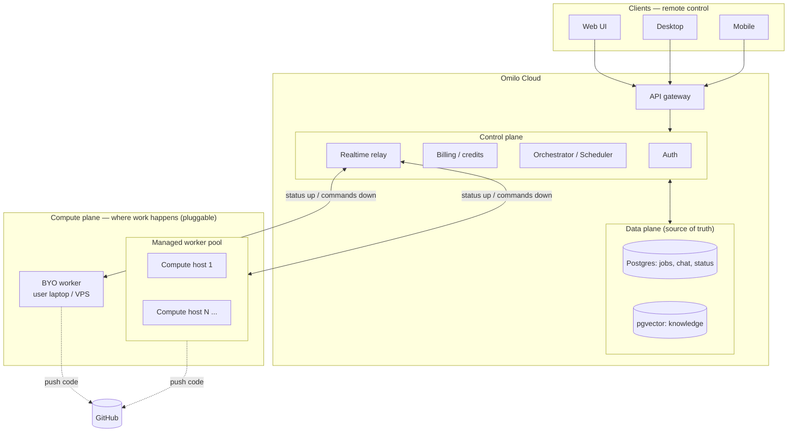
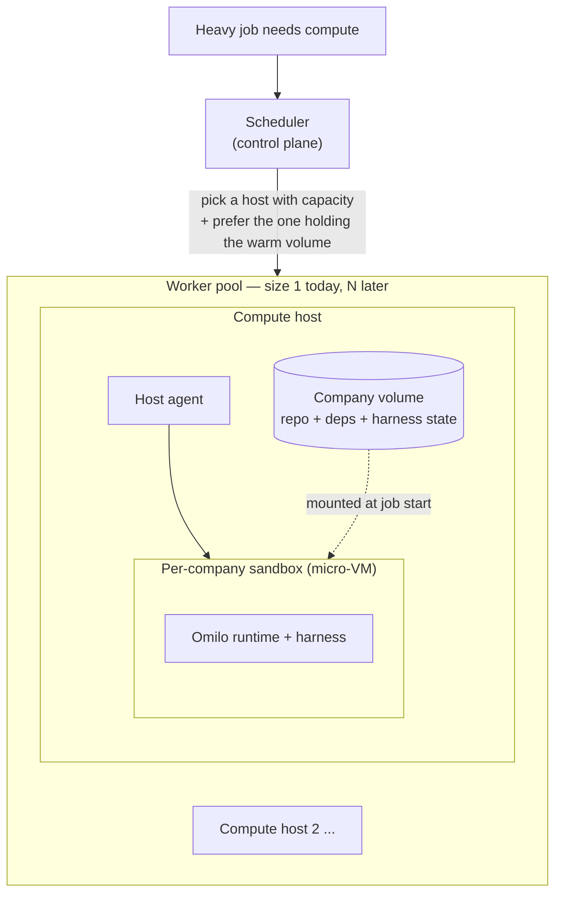
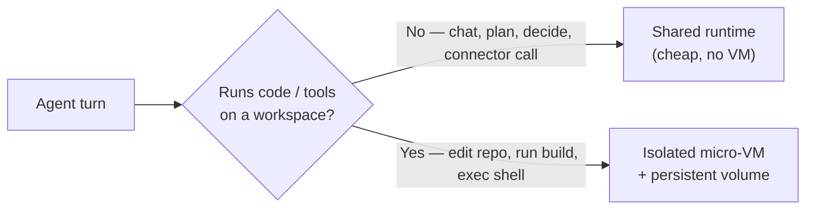
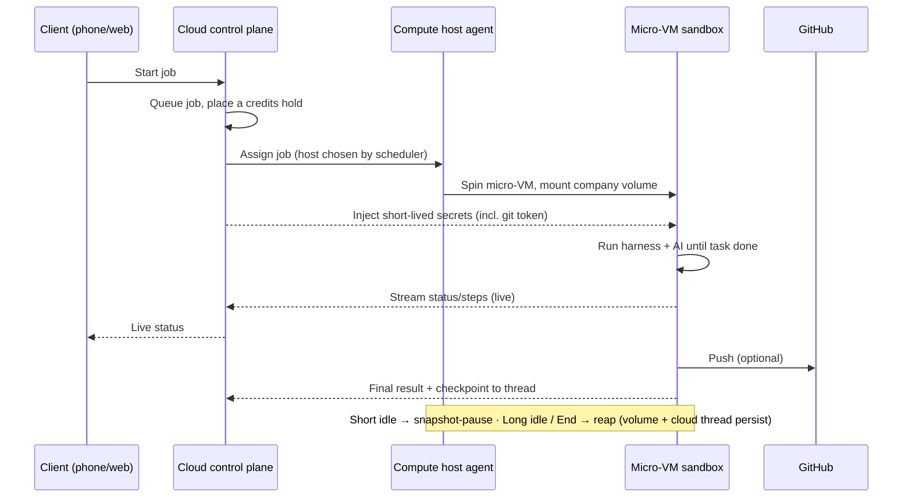
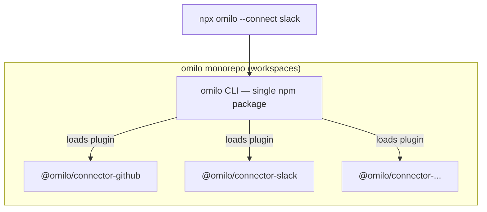
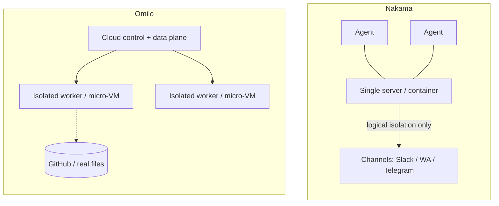

# Omilo Managed Cloud Compute — Architecture Design

**Date:** 2026-10-29
**Status:** Design (pre-plan). Nothing is built from this yet.

---

## 1. Intent & Why

Omilo is a *company of AI staff*. The difference from a chatbot platform is that Omilo's
agents don't just chat and call APIs — they **operate a real computer**: they drive coding
harnesses (Claude Code, Codex, Copilot, Gemini CLI, Cursor), edit real repos, run tools and
builds, and push to GitHub. The human controls all of this from web / desktop / mobile.

The mental model (one line):

> **The UI is the remote control, the Cloud is the control + data/sync plane, and the Compute
> runs the Omilo runtime + harness on a machine — one we host (managed) or one the user brings
> (self-host / `.dmg`). The work product (repo, files) lives on that machine until an agent
> pushes to GitHub; only job state, chat, and knowledge sync to the Cloud.**

We are building the **managed cloud** edition first, to monetize ASAP: a customer pays, and
gets agents that actually do work **without providing any machine of their own**. Omilo hosts
the compute.

This document is the architecture for that managed-compute edition, and how it coexists with
the bring-your-own-compute editions (which share the same runtime).

## 2. Goals

- Managed customers get working agents with **zero infrastructure on their side**.
- **Strong per-tenant isolation** — agents run arbitrary code, so a tenant's job can never see
  another tenant's code, files, or secrets.
- **No rework between jobs** — a persistent workspace (cloned repo, dependency cache, build
  cache, in-progress edits) survives across jobs.
- **No lost session context** across a compute teardown — durable state means a fresh sandbox
  can resume the exact session.
- **Control from any client** (web / desktop / mobile), with the Cloud as the single source of
  truth for job state and control.
- **Scale from 1 VPS to a pool** of hosts without re-architecting.
- **One simple CLI** for connecting a machine or a service: `npx omilo --connect <x>`.

## 3. Non-goals (v1)

- Multi-region / global edge compute.
- Hosting compute inside the customer's own cloud account (BYO-cloud managed).
- Per-**agent** VMs. Isolation is **per-company**, not per-agent.
- Rewriting the existing control/data plane (FastAPI + Postgres/pgvector) — we extend it.

## 4. Anti-goals (these make it a failure even if it "works")

- **One shared runtime executing every tenant's code** (the nakama-style single server). For an
  arbitrary-code workload this is a breach waiting to happen. This is the thing we are explicitly
  *not* doing for heavy jobs.
- **Baking secrets into images or volumes.** Secrets are injected short-lived at job start.
- **A design that only works on exactly one VPS** and needs a rewrite to add a second.
- **Losing a user's in-progress work** because a sandbox was reaped for being idle.

## 5. Constraints

- Existing stack to extend: FastAPI + Postgres (pgvector); credits billing via Doit (IDR);
  connectors feature; harness detection already built (Claude Code/Codex/Copilot/Gemini/Cursor).
- BYO workers (user laptops) are usually **behind NAT/firewall**, so **workers dial *out*** to
  the Cloud and hold a persistent connection; the Cloud never dials into a worker.
- We start with **one VPS** (cost). The design must scale to a pool later as a config/ops change.

---

## 6. Architecture overview

Three planes. The Cloud owns control + data; the Compute plane is where work happens and is
**pluggable** (user's machine or our managed pool — same runtime either way).

- **Control plane:** auth, billing/credits, the **scheduler** (places jobs on workers), and a
  **realtime relay** that carries commands down to workers and status up to clients.
- **Data plane:** Postgres holds jobs, chat threads, and live task status; pgvector holds
  knowledge. This is the synced source of truth every client reads.
- **Compute plane:** the Omilo runtime executes harness jobs. In managed, we host it as a
  **worker pool**. In BYO, the user's machine registers as a worker. **Files stay on the worker**
  until pushed to GitHub.

> Connection direction: the worker initiates the relay connection outbound (NAT-friendly). Arrows
> above show logical data flow, not who dials whom.

---

## 7. Managed compute: scheduler + worker pool (answers "1 VPS → pool?")

**Yes, it works — because we never address "the VPS," we address a *pool*.** Day one the pool has
exactly one host; later it has N. Adding hosts is registration + ops, not a rewrite.

- The **scheduler** treats compute hosts as a registerable set from day one. It places a job on a
  host with free capacity, and prefers the host that already holds that company's **warm volume**
  (*volume affinity* — avoids moving the workspace).
- Each **host agent** launches a **per-company sandbox** (a micro-VM) and mounts that company's
  **persistent volume** into it. The sandbox is disposable; the volume is durable.
- **Concurrency** (parallel agents) is capped per company by plan — this is a billing lever, and
  on day one it's also bounded by what the single VPS can hold.

**Phasing (so v1 is small):**

| Phase | Hosts | Isolation | Scheduler | When |
|-------|-------|-----------|-----------|------|
| 1 (v1, monetize) | 1 cheap VPS | Per-company **gVisor-sandboxed container** (+ seccomp, non-root, per-company netns, egress allowlist) | Pool-of-1, static capacity cap (~5–10 companies × 1–2 parallel) | Now |
| 2 | N VPS | Begin **micro-VM** migration (harden off gVisor before tenant count grows) | Pool with volume affinity + bin-packing | When users > 1 box |
| 3 | Autoscaled | Micro-VM standard | Autoscale + warm pool + snapshot-pause | Scale/latency demand |

The important discipline for v1: **build the scheduler against a pool interface even though the
pool is size 1.** No code says "the VPS." Then Phase 2 is adding rows to a hosts table.

---

## 8. Lightweight vs heavy routing (the nakama lesson, applied)

Not every "agent doing something" needs a micro-VM. Most agent activity is lightweight (chat,
planning, decisions, API/connector calls) and can run in a cheap shared runtime — exactly what
nakama does. Only jobs that **execute code/tools on a workspace** get an isolated sandbox.

This keeps isolation precisely where the risk is, and keeps the common case cheap — a big cost
win for the managed tier.

---

## 9. Job lifecycle & session continuity

**Session continuity — nothing is lost, as long as we persist two layers:**

1. **Omilo's task/chat thread** → streamed continuously to the **Cloud**. The conversation, what
   the agent did, and task status are durable independent of any sandbox.
2. **The harness's own session state** (e.g. Claude Code's transcript / `--resume` files) → kept
   on the **persistent volume**, not the ephemeral sandbox disk. A fresh sandbox mounts the volume
   and Omilo **resumes** the harness session. Where a harness lacks native resume, Omilo replays
   the thread from the Cloud into a fresh session.

Because real state lives on volume + Cloud, **warm-for-session is a latency optimization, not a
correctness requirement.** A fresh sandbox can reconstruct a session after an idle reap *or* a
crash. The only thing that doesn't survive a teardown is **live in-memory processes** (a running
dev server) — those restart; their files are on the volume.

**Idle policy (the dial between cost and "instant when I come back"):**

- **Short idle (~10–15 min): snapshot-pause** the sandbox (freeze to disk). Resume is seconds and
  costs ~nothing while paused. Feels warm, priced like cold.
- **Long idle (~30–60 min): reap** the sandbox. Volume + Cloud thread remain; next activity
  cold-starts and resumes.
- **Explicit "end": reap immediately.**
- These numbers are **plan-tiered** — higher tiers get longer warm windows.

---

## 10. Isolation & security model

- **Sandbox (v1): gVisor-sandboxed container** per company — a syscall-filtering user-space kernel
  (not a bare shared-kernel container). **Phase-2 hardening:** micro-VM (Firecracker/Kata). Because
  v1 uses gVisor (shared-kernel class), these controls are **v1 scope, not optional**: strict
  seccomp, non-root in-sandbox, per-company network namespace, no host mounts beyond the company's
  own volume.
- **Per-company volume** is only ever mounted into *that company's* sandbox. No shared mounts.
- **Secrets injected short-lived at job start** from the Cloud secret store (including the GitHub
  push token). Never written to the image or volume. A leaked volume leaks no long-lived creds.
- **Egress controls** on the sandbox (allowlist the model endpoints, package registries, the git
  remote) to limit exfiltration.
- **Credits hold** placed at job start, settled on completion (existing billing semantics).

---

## 11. Connectors & the `omilo` CLI (answers "split repos or one repo?")

**Recommendation: a monorepo with a single CLI entry point and plugin-based connectors.** Users
run one thing (`npx omilo --connect <x>`); you develop and release one repo.

- **One CLI package** (`omilo`) is the single, memorable entry point. `npx omilo --connect github`,
  `npx omilo --connect slack`, and `npx omilo --connect machine` (register this computer as a BYO
  worker) all go through it.
- **Connectors are plugins** behind a common interface, so a new connector doesn't fork the CLI.
  They live in the **same repo** as workspace packages (`@omilo/connector-*`), optionally
  publishable on their own later if independent versioning is ever needed.
- **Do not split into separate repos early.** Polyrepo fragments versioning, CI, and the release
  flow for no v1 benefit. A monorepo gives one repo, one release, and still allows separate npm
  packages via workspaces.
- The same CLI is how a **BYO machine registers as a worker**: `npx omilo --connect machine` does a
  device-pairing handshake (short-lived pairing code → the machine gets a scoped worker token and
  opens the outbound relay connection). This unifies "connect a service" and "connect a computer"
  under one UX.

---

## 12. Comparison with nakama

| Dimension | Nakama | Omilo (this design) |
|-----------|--------|---------------------|
| Compute model | All agents in one shared server/container | Control plane in cloud; **isolated worker per company** for heavy jobs |
| Isolation | Logical (roles/permissions) | **VM-grade** (micro-VM) for arbitrary code; logical for lightweight turns |
| Workload | Chat + tools + memory + API calls | **Runs real code**, edits repos, builds, pushes to GitHub |
| Persistence | Mounted data volume on the server | Cloud thread (status/chat) + **per-company workspace volume** on the worker |
| Reach to the world | Channels (Slack/WA/TG/Composio) | Connectors (same idea) + the compute itself |
| Where compute lives | The one server | **Pluggable**: user's machine (BYO) or our managed pool |
| Complexity / cost | Low — one container | Higher, but only where the risk is; lightweight turns stay nakama-cheap |
| Right when… | Agents chat and call APIs | **Agents operate a computer** (Omilo's differentiator) |

**Takeaway:** borrow nakama's shape for the control plane, connectors, and the *lightweight* agent
path (cheap, shared). Do **not** borrow its compute model for *heavy* jobs — that's precisely the
single-server trap. The added weight in Omilo is the moat, applied only to code-executing work.

---

## 13. Phased build order

- **Phase 0 (already have):** cloud control + data plane (FastAPI + Postgres/pgvector), connectors,
  harness detection, credits billing.
- **Phase 1 (v1 managed — monetize):**
  - Worker **runtime** + **host agent** running on one cheap VPS.
  - **Per-company gVisor sandbox** over a **persistent volume** + the hardening set (seccomp,
    non-root, per-company netns, **egress allowlist**); short-lived secret injection via a
    per-company **GitHub App** (repo-scoped, short-TTL tokens).
  - **Scheduler** against a *pool interface* (pool size 1), static cap sized for the pilot; **queue
    when full** + release the credits hold on no-placement.
  - **Job lifecycle + live status sync.**
  - **Session continuity for all five harnesses** behind a common `HarnessSession` interface:
    native `--resume` for Claude Code; a **thread-replay adapter** for Codex / Copilot / Gemini CLI
    / Cursor. Harness session state kept on the volume; thread checkpointed to the Cloud.
  - **Volume durability:** periodic snapshots + automatic checkpoint pushes.
  - **`omilo` CLI** (monorepo, plugin connectors) with `--connect machine` (BYO) and the first few
    service connectors.
  - **Managed-compute billing tier** (parallel cap + warm/cold as levers).
- **Phase 2:** worker **pool** (N hosts), volume affinity, bin-packing, warm pool.
- **Phase 3:** autoscale, snapshot-pause idle, hardened micro-VM everywhere, (later) multi-region.

---

## 14. Left to the builder (decisions to settle during the plan / a spike)

These are flagged, with my leanings, to resolve during planning or a quick spike on the chosen VPS:

- **Sandbox tech:** Firecracker vs Kata vs gVisor-container. *Lean:* Firecracker micro-VM for the
  end state; gVisor-container fallback for Phase 1 if the starter VPS lacks nested virt. **Spike
  this on the actual VPS first** — it gates Phase 1.
- **Control-plane ↔ worker protocol:** persistent gRPC stream vs WebSocket vs a broker (NATS).
  *Lean:* a single outbound WebSocket/gRPC stream per worker for v1 (simplest, NAT-friendly); a
  broker only when the pool grows.
- **Volume storage backend:** local disk on the host + periodic backup vs networked block storage.
  *Lean:* local disk + volume affinity for Phase 1; networked block storage when volumes must move
  between hosts (Phase 2+).
- **Scheduler:** custom (a hosts table + a placement function) vs an existing orchestrator (Nomad).
  *Lean:* custom and tiny for Phase 1 (one host!), revisit at Phase 2.
- **Connector plugin interface:** the exact contract a `@omilo/connector-*` package implements.

---

## 15. Open questions for the human (from the builder-check)

**Calls I settled myself** (a sensible builder could decide these; recorded as my call):

- **Git-token mechanism:** a per-company **GitHub App installation** issuing **repo-scoped,
  short-TTL** tokens, injected at job start. A cloud-side **push-proxy** (the sandbox never holds
  the token — it asks the Cloud to push) is a Phase-2 hardening, not v1.
- **Lightweight→heavy classification:** decided at the **tool layer** — a turn that invokes a
  *workspace tool* (shell / file-edit / build) is heavy and runs in a sandbox; a lightweight turn
  that reaches for a workspace tool **escalates** to a sandboxed job mid-turn. The "shared runtime"
  for lightweight turns is the existing backend worker pool.
- **Full-pool behavior:** when the box is at capacity, the scheduler **queues** (does not preempt a
  running job) and **releases the credits hold** if a job can't be placed within a timeout.

**Decisions confirmed by the owner (2026-10-29):**

1. **Launch host + isolation = cheap VPS + gVisor now.** v1 launches on a basic VPS using
   **gVisor-sandboxed containers** for per-company isolation (a real syscall-filtering sandbox —
   the same class Google uses for Cloud Run / GKE Sandbox), **not** micro-VMs. Micro-VM
   (Firecracker/Kata) is the **Phase-2 hardening**. *Residual risk to accept:* gVisor is a strong
   container sandbox but a shared-kernel boundary — weaker than a VM against a kernel-level exploit
   in tenant-run code. Mitigations that become **v1 scope** because of this choice: strict seccomp
   profile, non-root in-sandbox, tight **egress allowlist** (model endpoints + package registries +
   the git remote only), per-company network namespace, and no host-path mounts beyond the
   company's own volume. Revisit micro-VM before scaling tenant count materially.

2. **Durability = snapshots + push-checkpoints.** Periodic volume **snapshots** plus automatic
   **checkpoint pushes** bound un-pushed-work loss to minutes. No near-zero-loss replication in v1.

3. **Harness scope = all five** (Claude Code, Codex, Copilot, Gemini CLI, Cursor). *This enlarges
   v1:* harnesses without native resume need Omilo's **thread-replay** layer, so a **per-harness
   resume/replay adapter** is a Phase-1 work item (Claude Code uses native `--resume`; the others
   get a replay adapter, built behind a common `HarnessSession` interface). Replay fidelity is a
   correctness risk to test per harness.

4. **Launch scale = pilot** (~5–10 companies × 1–2 parallel agents). Size the single box for that,
   **queue when full**, revisit at Phase 2.
